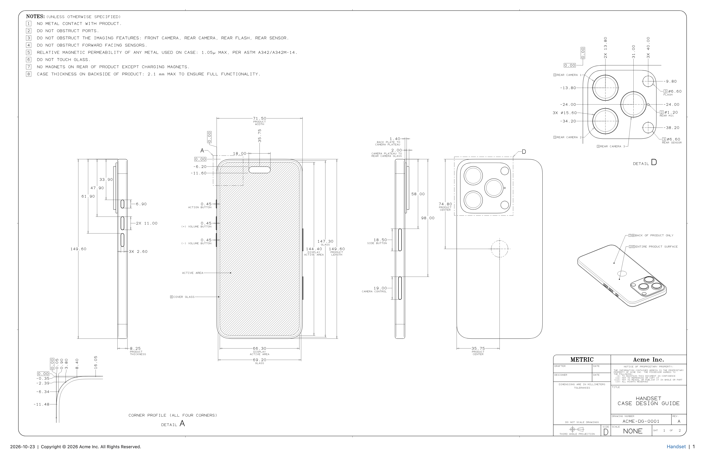
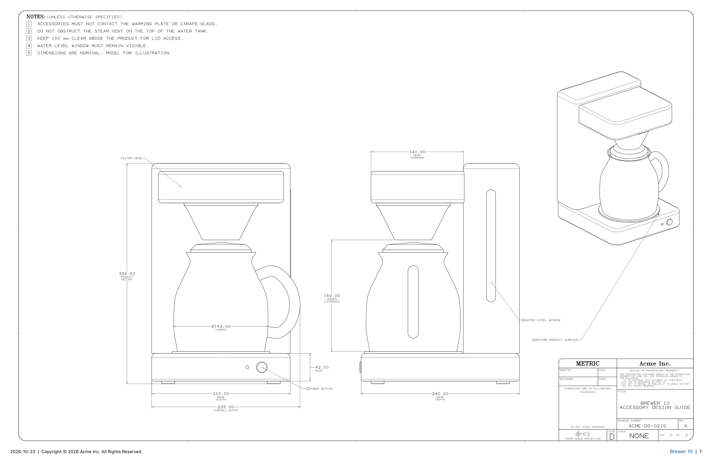
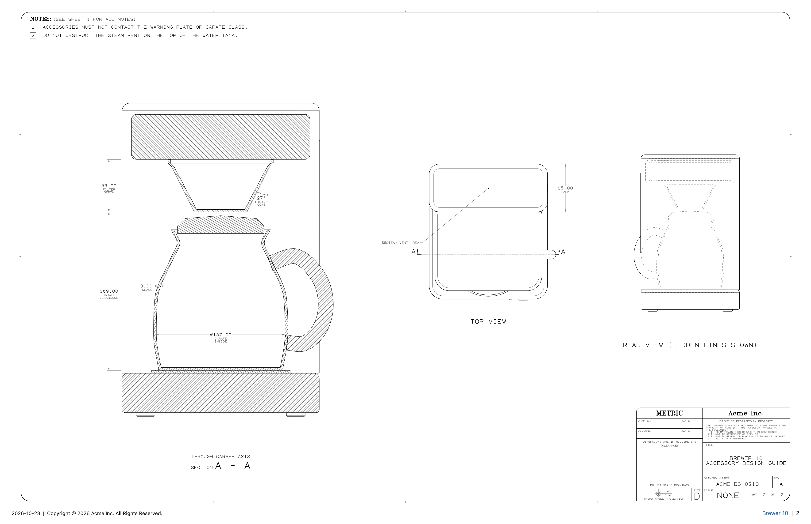
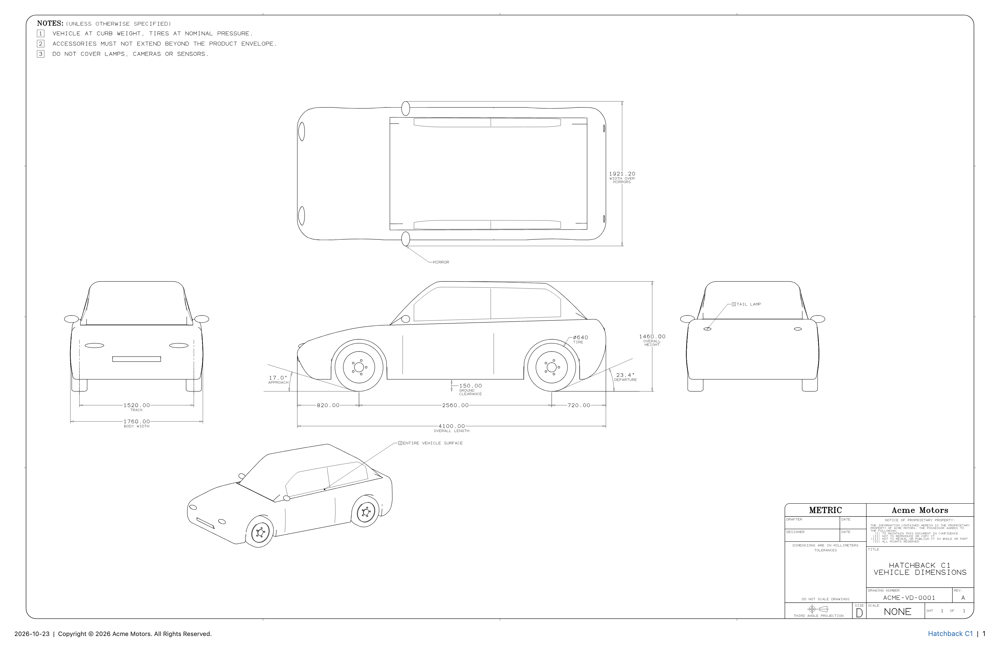

# Dimensional Drawing skill

An [Agent Skill](https://docs.claude.com/en/docs/claude-code/skills) that makes dimensional
drawings in the style of Apple's
[accessory design guides](https://developer.apple.com/accessories/dimensional-drawings/), for
any object. Phones and brackets are drawn as 2-D views. Coffee makers, cars and other complex
products are drawn from a 3-D model.

Ask your agent for "a dimension drawing of …" and it writes a short Python script with the
bundled library, renders the sheet, reads the checker's report and fixes what it finds.









## What it does

- **Apple's sheet layout:**
  - an ANSI D sheet with the rounded frame
  - the `NOTES:` block with boxed flag numbers
  - Apple's title-block layout and the footer
  - a monospaced single-stroke CAD font, with all text as vector paths
- **Dimensions measured from the geometry,** so the numbers can't disagree with the drawing:
  - linear, chain and baseline dimensions
  - ordinate dimensions with a boxed `0.00` datum and jogged leaders
  - `Ø`, `R` and angle callouts, and flag-note leaders
  - centre marks, detail and section callouts, and keep-out hatching
- **Automatic placement:** values stagger along stacked dimension lines, leaders avoid
  clutter, and centre lines break behind text.
- **3-D objects:**
  - Build the product once from extrusions (with holes and fillets), revolves, lofts,
    sweeps, spheres and tori, or import an STL/OBJ file.
  - The library generates the front, side, top, section, hidden-line and iso views with exact
    hidden-line removal, including the intersection curves between parts and hatched section
    cuts.
  - Helpers draw lines on curved surfaces, report which part sets each overall size, and
    compute a vehicle's approach and departure angles.
- **A checker on every save.** It reports:
  - overlapping text, and text crossed by lines
  - content outside the frame or inside the notes or title block
  - typed values that disagree with the geometry
  - dimension ends and extension lines that miss the part
  - `4X` counts that don't match the features drawn
  - flag numbers with no note, and detail letters with no view
  - projected views that don't line up
  - inverted 3-D sections, and parts that pass through each other
  - overall sizes that a part sticks out past, naming the part
- **Output:** SVG (the master copy), PNG, and single- or multi-page PDF.

## Install

With the [`skills`](https://github.com/vercel-labs/skills) CLI, which installs for Claude Code,
Codex, Cursor and many other agents (it asks which):

```sh
npx skills add Blueemi/dimension-draw-skill          # this project
npx skills add Blueemi/dimension-draw-skill -g       # all your projects
```

Or by hand: the skill is the `skills/dimensional-drawing/` folder, so put it where your agent
looks for skills.

**Claude Code**, for all your projects:

```sh
git clone https://github.com/Blueemi/dimension-draw-skill.git
mkdir -p ~/.claude/skills
ln -s "$PWD/dimension-draw-skill/skills/dimensional-drawing" ~/.claude/skills/dimensional-drawing
```

Use `cp -R` instead of `ln -s` if you'd rather have a copy. To install it for one project
only, use `.claude/skills/` inside that project.

**Codex:** `~/.codex/skills/dimensional-drawing`.

**Other agents that read Agent Skills:** `~/.agents/skills/dimensional-drawing`, or point the
agent at `skills/dimensional-drawing/SKILL.md`.

**Claude apps (claude.ai, desktop):** zip the folder and upload it in Settings under Skills.
Code execution must be on.

```sh
cd dimension-draw-skill/skills
zip -r ../dimensional-drawing.zip dimensional-drawing -x '*/__pycache__/*' '*/examples/out/*'
```

### Requirements

- **Python 3.8 or newer**, and nothing else. The library, including the 3-D engine, is pure
  Python.
- **For PNG and PDF** you also need one of:
  - any Chromium-family browser (Chrome, Edge, Brave, Chromium, Helium, Playwright's headless
    shell); set `DIMDRAW_CHROME` to choose one
  - `rsvg-convert`
  - `cairosvg`

  Without one, you get the SVG only.

## Use it

Ask in plain words and give real dimensions where you have them:

> Make a dimensional drawing of a drip coffee maker: base 210 × 240 mm, 334 mm tall, glass
> carafe with a handle. Front, side, section through the carafe and an iso view.

> Make an Apple-style case design guide for this phone: 71.5 × 149.6 × 8.25 mm, …

> Draw a vehicle package drawing for a compact SUV: 4600 long, 1855 wide, 1685 tall,
> 2690 wheelbase, with approach and departure angles.

The agent tells you which numbers it estimated and what it simplified. Each sheet comes out as
SVG, PNG and PDF.

### Using the library directly

```python
import sys
sys.path.insert(0, "skills/dimensional-drawing/scripts")
from dimdraw import Sheet

sh = Sheet("D", product="Widget", company="Acme Inc.")
sh.notes(["DIMENSIONS ARE NOMINAL."])
sh.title_block(title="WIDGET\nDIMENSIONS", drawing_number="ACME-0001", rev="A")
v = sh.view(x=300, y=300, scale=3.0, name="front")
body = v.rect(0, 0, 60, 40, r=4)
v.dim_h(body.tl, body.tr, offset=10, ref=body, label="PRODUCT\nWIDTH")
v.dim_v(body.tr, body.br, offset=10, ref=body, label="PRODUCT\nHEIGHT")
sh.save("out/widget.svg", pdf=True)      # prints the CHECK report
```

The skill's `SKILL.md` is the workflow the agent follows. The full API is in
`references/api.md`, and the guide to modelling complex objects is in
`references/modeling.md`.

## What's in the folder

```
skills/dimensional-drawing/
  SKILL.md                    workflow and rules the agent follows
  references/style-guide.md   what Apple puts on these sheets, and where
  references/api.md           full API
  references/modeling.md      modelling complex objects, and reading 3-D artifacts
  scripts/dimdraw/            the library
  scripts/zoom.py             render a region of a sheet at high resolution
  scripts/selftest.py         renders every example and fails on any check problem
  examples/template.py        starting point for a 2-D sheet
  examples/handset.py         2-sheet phone case design guide (overview and keep-outs)
  examples/flask.py           revolved product: elevation, section, iso
  examples/bracket.py         sheet-metal part on A3: hidden lines, hole patterns
  examples/coffee_maker.py    3-D model: every view, section A-A and a hidden-line rear view
  examples/car.py             3-D vehicle: lofted body, wheels, package dimensions, ramp angles
```

Run an example with `python3 skills/dimensional-drawing/examples/car.py`. Output goes to
`skills/dimensional-drawing/examples/out/`.

## Development

```sh
python3 -m unittest discover -s tests -v          # library unit tests
python3 skills/dimensional-drawing/scripts/selftest.py   # render every example, fail on any check problem
```

CI runs both on Python 3.9, 3.12 and 3.13.

## Limitations

- **It doesn't simplify for you.** The agent models what it is told. Faceted styling, wheel
  spokes, and detailed lamp or grille graphics take extra modelling work or are left out.
- **Speed:** rendering is pure Python. A 60k-triangle product takes about 8–12 seconds per
  sheet.
- **Rough meshes:** very coarse or noisy imported meshes show faceting. Raise the crease
  angle or the segment counts (see `references/modeling.md`).

## License and credits

MIT, see [LICENSE](LICENSE). The heading fonts are the Hershey fonts, whose notice is in
`skills/dimensional-drawing/assets/HERSHEY-FONTS-LICENSE.txt`.

The visual style follows Apple's published dimensional drawings. This project is not affiliated
with or endorsed by Apple Inc. The example products and companies are fictional, and the skill
tells agents not to put Apple's name or logo on drawings of non-Apple products.
